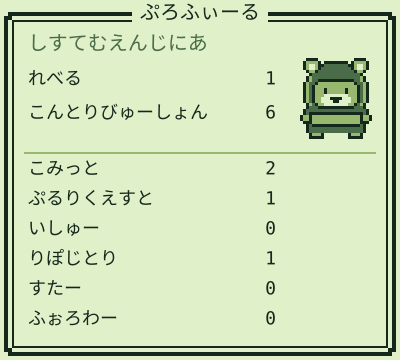
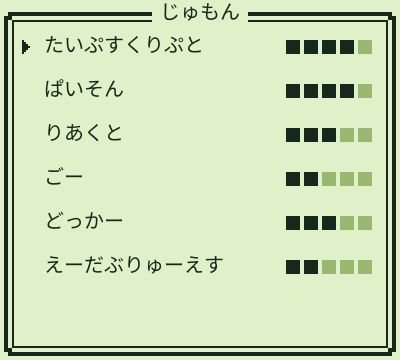

 

<!-- COMMANDS:START -->

  
  

<!-- COMMANDS:END -->

<picture>
  <source media="(prefers-color-scheme: dark)" srcset="https://raw.githubusercontent.com/cancan2542/cancan2542/output/github-snake-dark.svg">
  
</picture>

